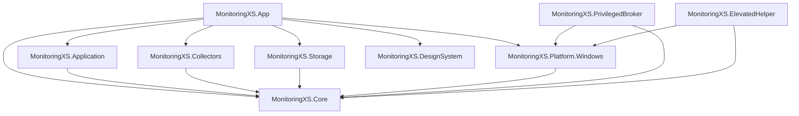

# نقشه وابستگی‌های Monitoring XS

این سند نقشه کامل وابستگی‌های ایستا و پویای پروژه Monitoring XS، بسته‌های خارجی و نقاط حساس پرریسک را مستند می‌کند.

---

## ۱. گراف وابستگی پروژه‌ها (Project Reference Graph)

### بررسی وابستگی‌های دایره‌ای (Circular Dependencies)
* **نتیجه:** **صفر وابستگی دایره‌ای.**
* جریان وابستگی کاملاً یک‌طرفه (Unidirectional / Inward) به سمت `MonitoringXS.Core` هدایت شده است.
* قوانین آزمون معماری در `ArchitectureBoundaryTests.cs` تضمین می‌کنند که هیچ وابستگی مستقیمی از Core، Collectors، Storage یا Platform به لایه‌های بالاتر ایجاد نشود.

---

## ۲. وابستگی به بسته‌های خارجی (NuGet Packages)

| پروژه | بسته خارجی | نگارش | هدف و نقش | ریسک وابستگی |
| :--- | :--- | :--- | :--- | :--- |
| `MonitoringXS.Core` | بدون پکیج خارجی | - | کد دات‌نت خالص | صفر |
| `MonitoringXS.Storage` | `Microsoft.Data.Sqlite` | 10.0.1 | ذخیره تاریخچه متریک‌ها در SQLite | کم؛ پکیج رسمی مایکروسافت |
| `MonitoringXS.Platform.Windows` | `Microsoft.Diagnostics.Tracing.TraceEvent` | 3.2.5 | مصرف رویدادهای هسته ETW | متوسط؛ ارتباط عمیق با لاگر کرنل |
| `MonitoringXS.App` | `Microsoft.WindowsAppSDK` | 1.8.260209001 | رندر WinUI 3 و XAML بر پایه AppWindow | متوسط؛ وابستگی به ران‌تایم ویندوز |
| `MonitoringXS.App` | `CommunityToolkit.Mvvm` | 8.4.0 | مدیریت وضعیت ViewModel و ویژگی‌های قابل مشاهده | بسیار کم؛ کتابخانه سبک استاندارد |
| `MonitoringXS.App` | `Microsoft.Extensions.DependencyInjection` | 10.0.1 | ترکیب سرویس‌ها (Inversion of Control) | بسیار کم؛ زیرساخت استاندارد دات‌نت |

---

## ۳. وابستگی‌های زمان اجرا و مسیرهای ارتباطی (Runtime & IPC)

### ۳.۱. ارتباط کلاینت و سرویس از طریق Named Pipe
* **مسیر:** بین `MonitoringXS.App` (پردازه کاربری استاندارد) و `MonitoringXS.PrivilegedBroker` (سرویس LocalSystem).
* **قرارداد:** پکیج پروتکل دوطرفه فریم‌بندی‌شده بر مبنای طول باینری در `PrivilegedEtwBrokerProtocol.cs`.
* **شناسه نشست:** تولید نام پایپ بر اساس هش SHA256 سه فیلد `User SID`، `Logon SID` و `Session ID`.
* **کنترل ریسک:**
  * سرویس اجازه اتصال کاربران سایر نشست‌ها را نمی‌دهد.
  * کلاینت قبل از تلاش برای اتصال، وضعیت سرویس را از SCM استعلام می‌کند تا در صورت خاموش بودن، ترافیک سربار پایپ تولید نشود.
  * در صورت قطعی سرویس، به صورت خودکار متریک دیسک/شبکه به وضعیت `Unavailable` یا `Partial` تنزل می‌یابد بدون آنکه مانیتورینگ پردازنده یا حافظه مختل شود.

### ۳.۲. جریان اسنپ‌شات‌ها (In-Memory Channel Hub)
* **مسیر:** از `MonitoringRuntime` به `MonitoringSnapshotHub` و سپس اشتراک برای پنجره اصلی و ابزارهای مانیتورینگ.
* **سازوکار:** استفاده از `Channel<MonitoringSnapshot>` بدون بافر نامحدود.
* **کنترل ریسک:** مصرف‌کننده‌ای که کند باشد، صف را مسدود نمی‌کند؛ آخرین اسنپ‌شات در دسترس قرار می‌گیرد.

---

## ۴. ماژول‌های پرریسک و با اثرگذاری بالا (High-Impact Modules)

1. **`MonitoringCoordinator` (در لایه Application):**
   * **دلیل:** نقطه تقاطع تمام کالکتورها و تولیدکننده اسنپ‌شات‌های تغییرناپذیر.
   * **اثر تغییر:** هرگونه تغییر در امضای متد یا فیلدهای خروجی آن مستقیماً در داشبورد، تاریخچه، و محاسبات سیستم منعکس می‌شود.
   * **سپر محافظ:** آزمون‌های یکپارچه‌سازی و پایپ‌لاین در `MonitoringCoordinatorTests` و `MonitoringCapturePipelineTests`.

2. **`ApplicationAttributionService` (در لایه Platform):**
   * **دلیل:** تعیین‌کننده اینکه کدام پردازه متعلق به کدام نرم‌افزار است و آیا باید پنهان شود یا خیر.
   * **اثر تغییر:** خطا در این ماژول می‌تواند نرم‌افزارهای سیستمی را جای نرم‌افزارهای کاربر نشان دهد یا نرم‌افزارهای بدافزاری را مخفی کند.
   * **سپر محافظ:** آزمون‌های هویت‌سنجی و سناریوهای جعل در `ApplicationAttributionTests`.

3. **`SqliteMetricHistoryStore` (در لایه Storage):**
   * **دلیل:** نگه‌دارنده جداول نشست‌ها و نمونه‌های ثبت‌شده.
   * **اثر تغییر:** تغییر در اسکیما یا فرآیند Downsampling ممکن است به از دست رفتن داده‌های تاریخی یا افت شدید پرفورمنس منجر شود.
   * **سپر محافظ:** ۴۰ آزمون رگرسیون ذخیره‌سازی در `MonitoringXS.Storage.Tests`.
